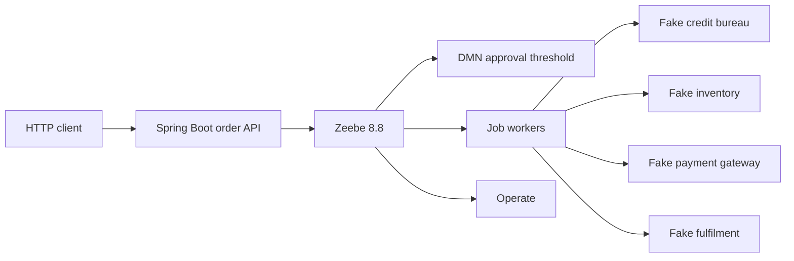
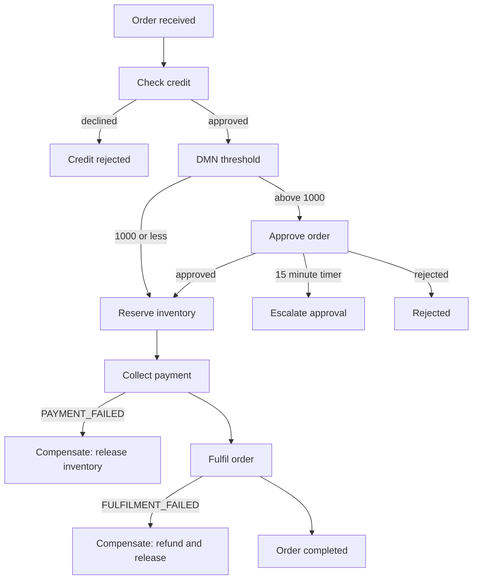

# Order approval workflow

A Camunda 8 (Zeebe) order-approval process for a portfolio demo. A Spring Boot service starts an order, job workers call in-memory stand-ins for credit, inventory, payment, and fulfilment, and a DMN table decides when a person has to approve the amount.

This is a portfolio demo for Arpan Bom's CV. The credit bureau, warehouse, and payment gateway are fakes with fixed rules. Nothing here talks to a real bank, carrier, or bureau, and there are no API keys.

## What it does

1. An order is received.
2. A credit check either stops the order or lets it continue.
3. The DMN decision `approval-threshold` reads `amount`. **1000 or less** continues on its own. **Above 1000** waits on the user task `Approve order`.
4. If that task is still open after **15 minutes**, a non-interrupting timer runs `escalate-approval`. The approval task stays open.
5. Inventory is reserved, then payment is collected, then the order is fulfilled.
6. If payment is declined, compensation **releases the reservation**. The charge never completed, so it is not refunded.
7. If fulfilment fails after payment, compensation **refunds the payment** and **releases the stock**.

The approval user task is the job-worker kind (`io.camunda.zeebe:userTask`). It does not use the `zeebe:userTask` extension. Zeebe Process Test's embedded engine cannot complete Camunda user tasks, and these tests are required to run without Docker. Tasklist's newer user-task API may not list this task. The process tests complete the job directly.

## Architecture





## Metrics

Not measured. This demo does not include a benchmark.

| Figure | Result |
| --- | --- |
| Throughput | Not measured |
| End-to-end latency | Not measured |
| Engine resource use | Not measured |

## Run it locally

Requirements: JDK 21, Maven 3.8 or newer, and Docker Compose 2.24 or newer if you want Zeebe and Operate. The tests do not need Docker.

The Compose file runs Elasticsearch plus Camunda `8.8.42`. That one image includes the Zeebe broker, the gateway, Operate, and Tasklist. It is a local stack, not a production deployment. Elasticsearch often needs `vm.max_map_count` raised on the host (`sudo sysctl -w vm.max_map_count=262144`) before it will start.

```bash
docker compose up -d
mvn spring-boot:run
```

| Surface | URL |
| --- | --- |
| Order API | http://127.0.0.1:8096 |
| Zeebe gRPC | `127.0.0.1:26500` |
| Operate | http://localhost:8088/operate |
| Tasklist | http://localhost:8088/tasklist |

Operate's local user is Camunda's published demo account: `demo` / `demo`. The orchestration API in this compose file is unprotected. Those values are for a laptop only.

Start an order:

```bash
curl -s -X POST http://127.0.0.1:8096/api/orders \
  -H 'Content-Type: application/json' \
  -d '{"orderId":"ord-1001","customerId":"cust-42","amount":1250.00,"currency":"EUR"}'
```

The process instance key is a string. Zeebe keys do not fit in a JavaScript number.

Fake rules, so you can force paths without a real backend:

| Input | Result |
| --- | --- |
| `customerId` starts with `blocked-` | Credit check declines the order |
| `amount` above `1000` | Manual approval |
| `orderId` starts with `payfail-` | Payment worker throws `PAYMENT_FAILED` |
| `orderId` starts with `shipfail-` | Fulfilment worker throws `FULFILMENT_FAILED` |

`GET /api/health` does not need Zeebe. `POST /api/orders` does. If the broker is down, the start call returns HTTP 503.

## Test it

```bash
mvn test
```

`OrderApprovalProcessTest` uses Camunda's `zeebe-process-test` embedded engine (JDK 21, no Docker). It deploys the BPMN and DMN and covers:

- happy path at the 1000 threshold, with no manual approval
- credit rejection
- approver rejection
- payment failure compensation (the reservation is released)
- fulfilment failure compensation (refund and stock release)
- the 15 minute escalation timer, after which the approval can still finish

`WorkerTest` checks the workers against the fake backends, including the BPMN errors they throw. `OrderControllerTest` checks the REST API without a broker.

GitHub Actions runs the same `mvn test` command on JDK 21. This repository does not publish a measured runtime for that job.

## Stack

- Java 21, Spring Boot 3.5, Camunda Spring Boot Starter `8.8.42` (the Camunda Spring SDK that replaced Spring Zeebe)
- Zeebe Process Test `8.8.42` embedded engine

Zeebe Process Test is deprecated in 8.8 and removed in 8.10. This project stays on 8.8.42 so the embedded tests keep working without Docker.

## License

MIT. Copyright 2026 Arpan Bom.
